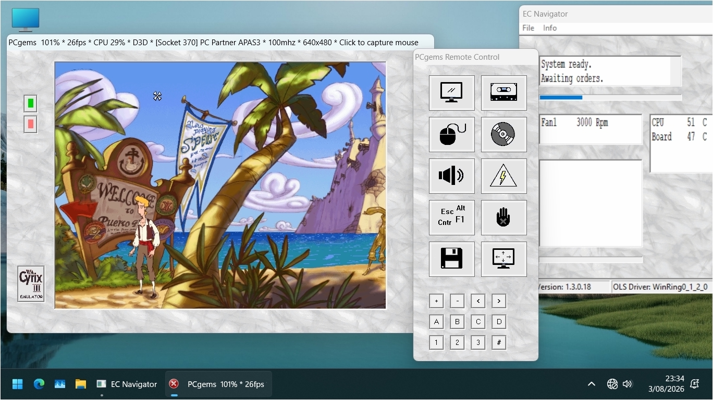
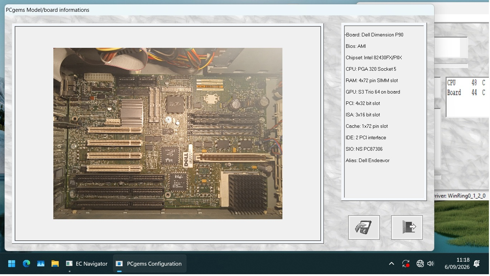

#	PCgems

 
        PCgems is an emulator of little hardware gems from the 80s 
and 90s based on SWEET. 
	PCgems has a friendly and easy to use interface, support more
than 300 preconfigured models and adds a lot of picture and info
about the emulated hardware. 
	All XT machines are equipped with 512/640 Kb of RAM and 10 Mb 
MFM/RLL hard disc; LCC 68 based machines have 1024/4096 Kb of RAM 
and 10/20 Mb IDE/ESDI hard disc; QFP 100 and PGA 132 machine have up to
16 Mb of RAM and 20/40 Mb IDE/SCSI hard disc; other AT machines have 
customizable RAM/DISC size through the machine bios setup. 
	It is also possible to add photos and images of your favourite
hardware and look them inside PCgems toghether with the machine. 
	Available in six languages.
  

  

  

	INSTALLATION
  
	- Download from the /Packages repository the PCgems Main Pack
and unpack it in your favourite folder (Ex: C:\Apps\PCgems); 
	- Download (optionally) from the /Packages repository the PCgems 
Picture Pack and unpack it in the PCgems folder, eventually 
merging existing folder (Ex: C:\Apps\PCgems\pics); 
	- Download (optionally) from the /Packages repository the PCgems 
Small Games Pack and unpack it in the PCgems folder, eventually 
merging existing folder (Ex: C:\Apps\PCgems\floppy); 
	- Download (optionally) from the /Packages repository the PCgems 
Small Cassette Pack and unpack it in the PCgems folder, eventually 
merging existing folder (Ex: C:\Apps\PCgems\cassette); 
	- Put your cdrom images (.cue, .iso) in the /cd folder; 
	- Put your floppy disc images (.img) in the /floppy folder; 
	- Put your cassette images (.wav, .pzx) in the /cassette folder; 
	- Put your photos (.bmp 4:3) in the /photo folder; 
  

  

  

	EMULATION
  
	- In the PCgems folder, start the edition that best fit
with your machine (32 bit or 64 bit); the PCgems Configuration 
Manager window will open; 
	- In the PCgems Configuration Manager, click on the top 
right icon with the computer picture; the PCgems Model Selection
dialog window will open; 
	- In the PCgems Model Selection dialog windows, select 
the desired model in the left box; on the right you can find 
some boxes to filter the machine list based on chipset, bios, 
manufacturer, year, ecc... 
	- Once selected the desired machine, click the bottom
icon  with the save-to-disc picture; this will return to the
PCgems Configuration Manager; 
	- In the PCgems Configuration Manager, click on the top 
middle icon with the play-arrow picture; this will launch the
emulator; 
	- Once the PCgems Emulation Box starts, you can open 
the PCgems Remote Control by clicking the green button on the top
left; there you can find more options to pause the emulator (hand 
icon), reset the emulator (flash icon), insert/remove floppy
(floppy icon), ecc... 
 
	PCgems works fine under Windows XP, Vista... Windows 11. 
	 
        I hope you enjoy it.

  

